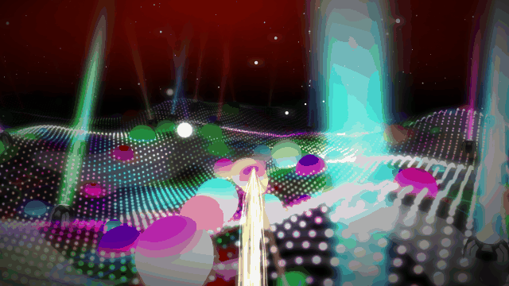
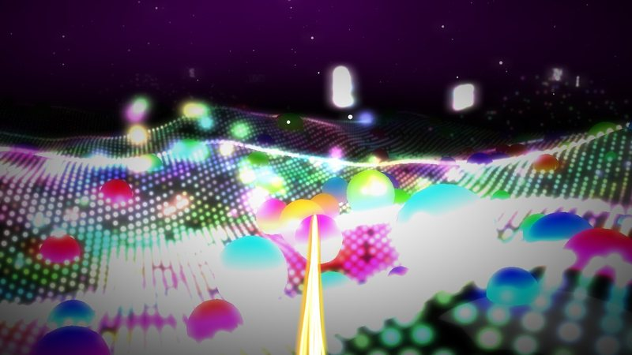
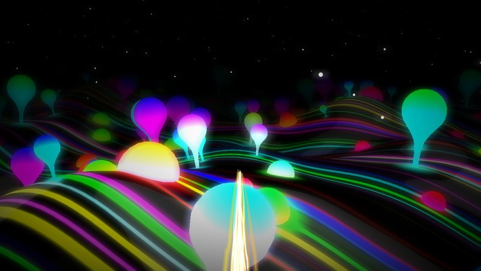
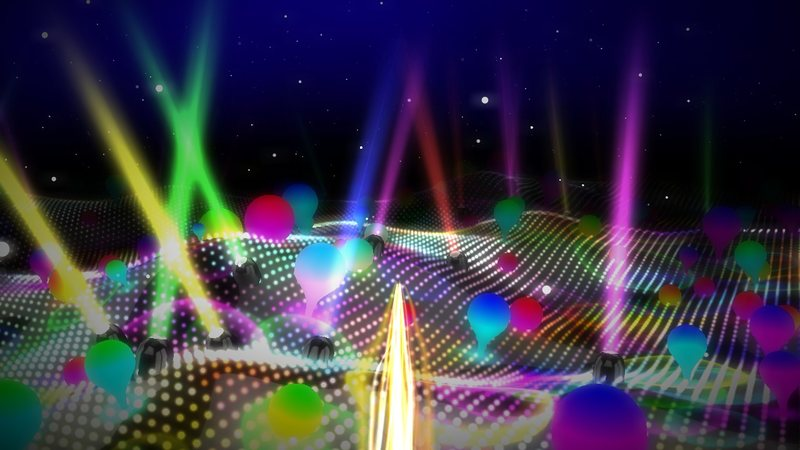
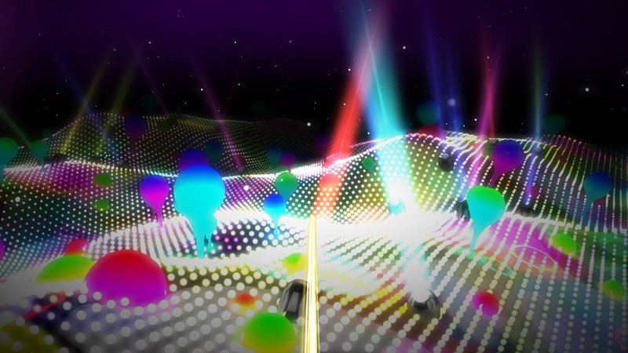
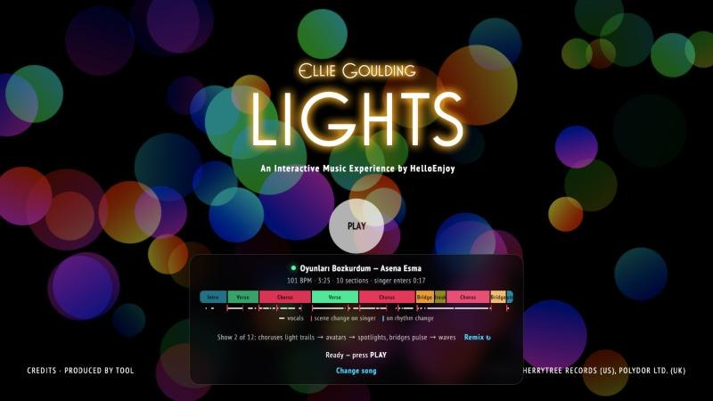
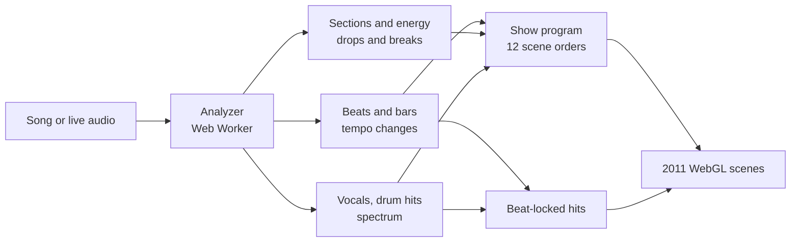

<div align="center">

# Lights · any song

### HelloEnjoy's 2011 WebGL music experience, taught to dance to *your* music.

Upload a track, or let it listen to a browser tab, and the whole show is choreographed around it:
the beat, the bars, the choruses, the breaks and the moment the singer comes in.

<a href="https://danialza.github.io/Lights/"></a>


<br><br>



<sub>The final-chorus scene driven by an uploaded song: every beat throws the spotlights into a new formation.</sub>

</div>

---

## ✨ What it does

<table>
<tr>
<td width="33%" valign="top">

### 🎧 Listens

Tempo, beats and bars, energy, choruses and breaks, drum hits, tempo changes, and where someone
is singing. All of it is analyzed in about a second, in a Web Worker, right in your browser.

</td>
<td width="33%" valign="top">

### 🎬 Directs

The 2011 show has 23 scenes hand-timed to one song. Here they are fitted to *your* song's
structure, and every scene change lands on the singer's entry, a drop or a change in the rhythm.

</td>
<td width="33%" valign="top">

### ⚡ Hits on the beat

Every beat lands as an instant hit: a camera punch, a flash in the sky, pumping ground lights,
spotlights snapping into a new formation. Harder on the first beat of each bar, still in the breaks.

</td>
</tr>
</table>

## 🖼 Scenes

<table>
<tr>
<td width="50%"><br><sub><b>Light trails</b> · the ground dots pump on every beat</sub></td>
<td width="50%"><br><sub><b>Verse</b> · balloons over glowing terrain lines</sub></td>
</tr>
<tr>
<td width="50%"><br><sub><b>Spotlights</b> · moving heads that jump on the beat</sub></td>
<td width="50%"><br><sub><b>Bridge</b> · the ground ripples with the music's spectrum</sub></td>
</tr>
</table>

Every song gets its own running order, one of **12 shows**: the three chorus scenes in any order
and the two bridges either way round, each show with its own camera framing and sky colour.
**Remix** steps through them.

## 🚀 Try it

1. Open **[the live demo](https://danialza.github.io/Lights/)** in desktop Chrome or Edge.
2. Pick a source: **Upload a song** (or drop a file on the page), **Playing audio**,
   **Microphone**, or the **Original song**.
3. Wait about a second for the analysis, then press **PLAY**. Move the mouse to steer the voice,
   click to fly faster.

<p align="center"></p>

The panel shows what the analysis found: tempo, length, when the singer enters, the song's
sections, where the vocals are (white) and why each scene starts where it does (pink: the
singer, yellow: a tempo change, cyan: a rhythm change).

Songs you upload are **remembered in your browser** (IndexedDB, never sent anywhere): open the
page again and your latest song is already loaded. Remove one with its ✕.

| Source | What happens |
| --- | --- |
| **Upload a song** | The whole file is analyzed first, so the show knows the song's structure in advance. MP3, WAV, OGG, M4A, FLAC: whatever the browser can decode. |
| **Playing audio** | Share a browser tab (or the screen) with **Share audio** ticked. Tempo, beats, the singer and drops are followed live. Desktop Chrome or Edge. |
| **Microphone** | The same live analysis on whatever the mic hears: speakers in the room, a band. |
| **Original song** | Ellie Goulding's *Lights* with the original hand-made timing. |

### Keys

| Key | During playback |
| --- | --- |
| Mouse / click | Steer the voice / fly faster |
| `H` | Show the current section, BPM and why the scene started |
| `T` | Tap-sync: tap `Space` on the beat 8 times to measure your speakers' delay (Bluetooth, TV) |
| `[` `]` | Shift the visuals 10 ms later / earlier |
| `Esc` | Back to the start screen (live mode plays the outro first) |
| `R` | On the start screen: remix the show |

## 🧠 How it works



<details>
<summary><b>Analysis</b>: what the Web Worker extracts</summary>

- **Beats**: tempo from onset-strength autocorrelation (the octave is chosen from where kick and
  snare repeat), then a dynamic-programming beat tracker (Ellis 2007, as in librosa) that
  follows tempo changes.
- **Bars**: the 4/4 bar phase, from bass hits and chord changes.
- **Sections**: per-bar energy (loudness, bass, onset density), plus novelty in timbre, harmony
  and the 16-step drum pattern.
- **Singer**: centre-panned energy in the voice range combined with pitch movement (vibrato and
  slides, which synths, bass and keys don't have).
- **Tempo changes**: local tempo every second; lasting changes of more than 6 % become scene
  changes.
- **Drum hits**: kicks, snares / claps and hi-hats per frequency band, plus accents and drops.
- **Curves**: a 64-band spectrum and a vocal-volume curve at 60 fps, in the same units as the
  original's hand-made data.
- Uploads are decoded at a fixed 22,050 Hz, so the analysis is identical on every computer.

</details>

<details>
<summary><b>Choreography</b>: fitting 23 hand-timed scenes to a new song</summary>

The original runs intro → verse → chorus → verse → chorus → bridge → break → chorus → bridge →
outro. A dynamic-programming fit places those parts on the new song's bars: high-energy scenes
land on choruses and drops, the "break" freeze lands on the biggest breakdown before a big
return, and the outro fades with the song's end. Each scene change is then pulled onto the
nearest strong musical event within about a bar: the singer coming in or stopping, a tempo
change, or a rhythm change.

In the original, some scenes leave things behind for the scene that follows them (words floating
in the air, a flattened ground, spotlights left on). When a show changes the order, short
transitions clean up: the words explode, the ground grows back, the spotlights switch off.

</details>

<details>
<summary><b>Sync</b>: why it feels locked to the beat</summary>

Gliding motion reads as late even when it starts on time, so every reaction is **instant on the
beat** and fades within about 0.15–0.3 s:

| Musical event | Reaction |
| --- | --- |
| Beat (harder on the bar's first beat) | Camera zoom-punch and dip; sky, spotlights and terrain flash; ground dots pump; spotlights jump to their next position |
| Clap / snare on beats 2 and 4 | White sparks on the ground |
| Hi-hat on a beat or half-beat | Stars sparkle |
| Accent on a beat | Balls inflate / deflate |
| Singer comes in | The voice's sparkler flares, stars burst |
| Drop, return after a break | The whole ground flashes white, strongest zoom |
| Loudness | The camera cruises slower in quiet parts, faster in loud ones |

Off-beat kicks and percussion fills are left out, so the picture pulses instead of flickering.
Visuals are drawn about 35 ms ahead of the player's position, the time a frame takes to reach
the screen. Chrome's player position already includes the sound card's latency, and `T`
measures any extra delay added by wireless speakers.

Live audio uses a real-time tempo estimate and a phase-locked beat clock that fires predicted
beats slightly early. The singer coming in, or a lasting tempo change, starts the next scene on
the following bar.

</details>

## 📏 Measured

| What | Result |
| --- | --- |
| Tempo of the original song | 120.2 BPM (actual: 120) |
| Break, final chorus and outro vs. the original's hand-made timing | within 0.5 s |
| Singer detection vs. the original's real vocal track | 98 % of "singing" frames correct; first entry at 7.3 s (real: 7.2 s), last note at about 200 s (real: 200.25 s) |
| Tempo changes on a 90 → 120 → 100 BPM test track | found at 63.9 s and 128.8 s (real: 64 s and 128 s) |
| Big visual changes landing on the beat, per scene | 83–100 %, measured from the rendered frames |

## 💻 Run locally

There's no build step, but the page needs a local web server (browsers block the analyzer and
the image reads on `file://`). In this folder:

```bash
python3 serve.py
```

Then open <http://localhost:8000>. On macOS you can also double-click **`start.command`**.
Songs dropped into **`my-music/`** appear as buttons in the picker and stay out of git.

```text
js/smart/analyzer-worker.js   song analysis (Web Worker)
js/smart/SmartLights.js       picker, shows, beat-locked reactions, live engine
css/smart.css                 picker and HUD styles
serve.py, start.command       local no-cache server and launcher
my-music/                     your own songs (git-ignored)
docs/                         images for this README
```

Everything is layered on top of the original code by patching its prototypes at load time. The
original files are untouched, except `index.html` (it loads the new files and drops the original
site's analytics snippet) and a one-line fix to the end-of-song fade, which assumed a 210-second
song.

## ⚠️ Limitations

- Capturing system-wide audio depends on the browser and the OS. On macOS, sharing a tab is the
  reliable option, or route system audio into a virtual input such as BlackHole and pick
  **Microphone**.
- The scene fitting assumes 4/4 and a pop or electronic build. Free-tempo music still pulses with
  the beats and energy, but its sections are rougher.
- Vocal detection doesn't use machine learning: a centre-panned lead instrument with vibrato
  (clarinet, violin, ney) can count as singing.
- Tested in desktop Chrome. Other browsers may work but haven't been tested.

## 🙏 Credits

The original experience is by [HelloEnjoy](http://helloenjoy.com) (Carlos Ulloa) for Ellie
Goulding's *Lights* (© 2011 Cherrytree Records / Polydor). The upstream repository has no
license file, so the original code, images and music remain with their authors. The additions in
this fork are `js/smart/`, `css/smart.css`, `serve.py`, `start.command` and `docs/`.
